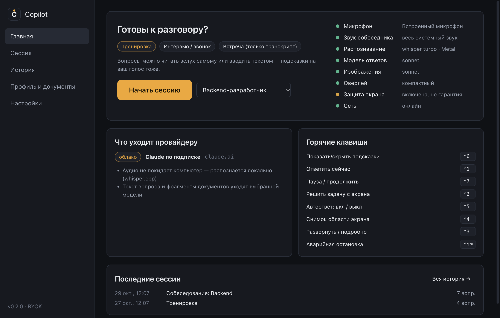
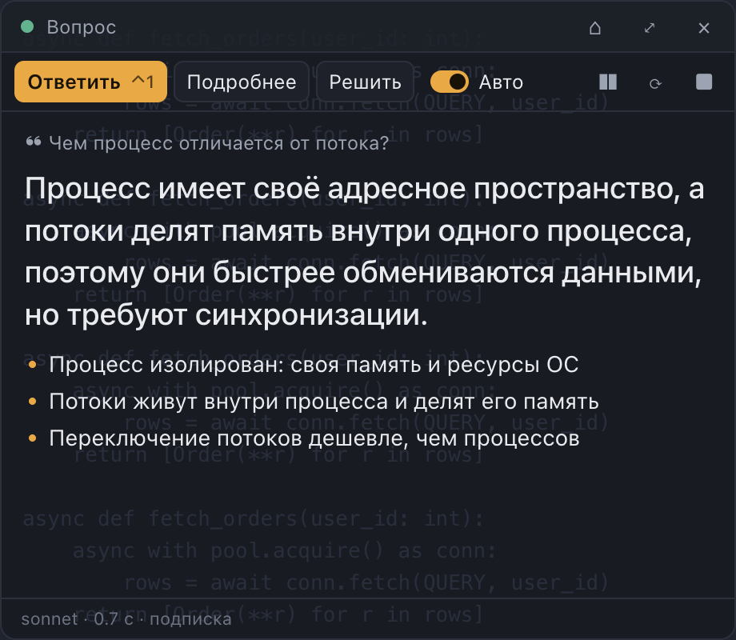
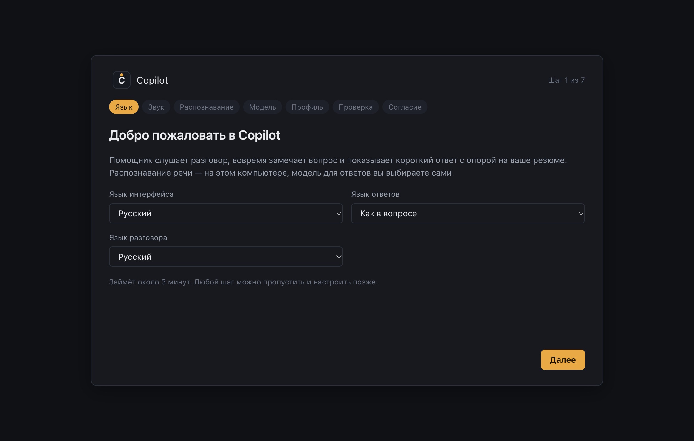
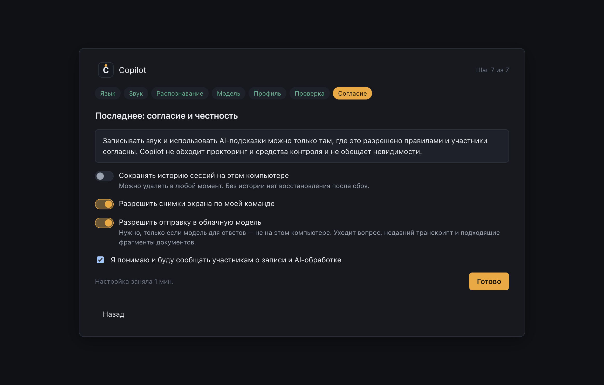
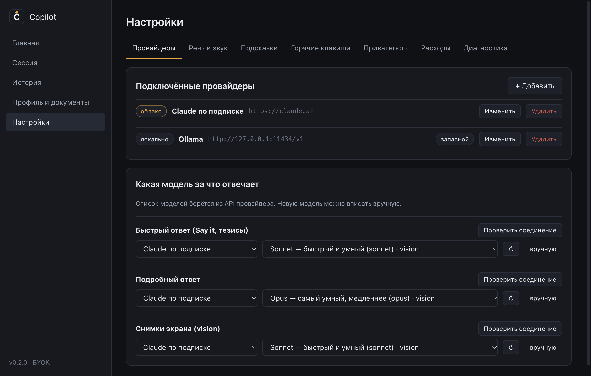
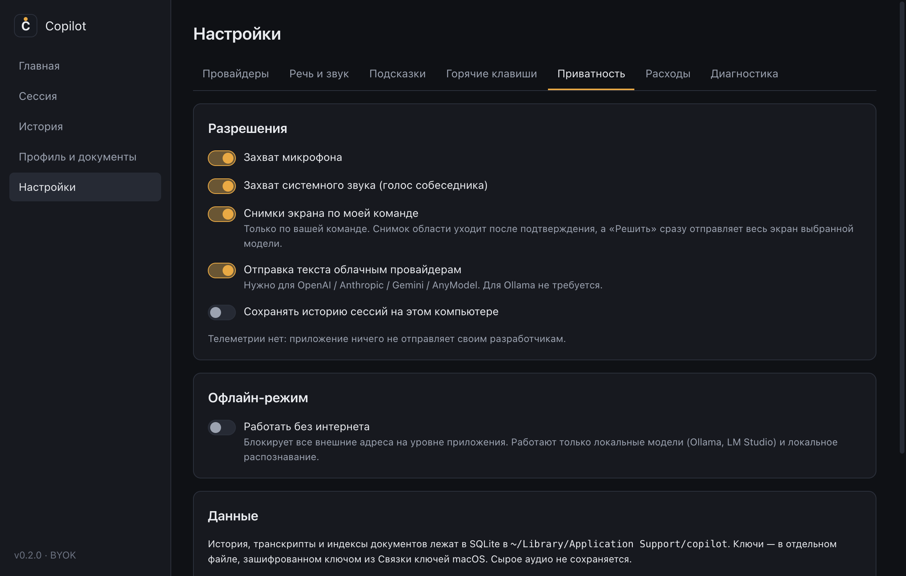

# Copilot для macOS

Подсказки на собеседовании и встрече. Приложение слушает разговор, распознаёт речь прямо на компьютере, замечает вопросы и показывает короткий ответ в небольшом окне поверх остальных.

Это форк [Magerko/copilot](https://github.com/Magerko/copilot), написанного для Windows. Здесь он перенесён на Mac с Apple Silicon и дополнен. Сборка под Windows осталась, но в этом форке на Windows не проверялась.

## Что умеет
- **Распознавание речи на компьютере.** whisper.cpp работает локально на Metal: аудио не уходит в сеть и не пишется на диск.
- **Ответы от выбранной модели:** локальной (Ollama, LM Studio), облачной по ключу (OpenAI, Anthropic, Gemini, любой OpenAI-совместимый сервис) или Claude по вашей подписке.
- **Опора на ваши документы.** Загрузите резюме и описание вакансии. Чего в них нет, то помечается `[нет в резюме]`, а не выдумывается.
- **Решение задачи с экрана.** Одна клавиша снимает экран, модель пишет решение и разбирает видимый код, если он есть. Можно снять и только выделенную область.
- **Работа из маленького окна.** Кнопки ответа, тумблер автоответа и пауза под рукой, главное окно на время сессии сворачивается.
- **Учёт расходов** по платным моделям, лимиты и офлайн-режим, который блокирует внешние запросы.

## Что добавлено к оригиналу
- Порт на macOS: сборка под Apple Silicon, подпись, whisper.cpp из Homebrew, системный звук через ScreenCaptureKit.
- Claude по подписке через официальный Claude Code CLI, без API-ключа.
- Пул API-ключей: при лимите запрос сразу уходит на следующий ключ.
- Решение задач с экрана одной клавишей.
- Кнопки и автоответ в окне подсказок, сворачивание главного окна.
- Лучше ловит тихую и короткую речь, меньше нагружает процессор и видеокарту.
- Горячие клавиши на цифрах: нажимаются одной рукой и не зависят от раскладки.

## Скриншоты
Скриншоты сделаны автором оригинала в Windows, на Mac оформление окон отличается.



| Окно подсказок | Прозрачный фон |
|---|---|
|  |  |

| Первый запуск | Согласия |
|---|---|
|  |  |

| Провайдеры | Приватность |
|---|---|
|  |  |

## Установка на Mac
Нужны macOS 13 или новее, Apple Silicon, [Node.js](https://nodejs.org) и [Homebrew](https://brew.sh). Готовой сборки нет, приложение собирается из исходников.

```bash
git clone https://github.com/filooww/copilot.git
```

```bash
cd copilot && npm install
```

```bash
brew install whisper-cpp
```

```bash
npm run install:mac
```

Приложение появится в «Программах». При первом запуске разрешите доступ к микрофону и записи экрана: без второго разрешения не будет слышно собеседника.

macOS привязывает разрешения к подписи приложения. Чтобы не выдавать их после каждой сборки, создайте в Связке ключей самоподписанный сертификат для подписи кода с именем `Copilot Dev`. `scripts/sign-mac.sh` найдёт его сам, а без него подпишет приложение ad-hoc.

### Claude по подписке
Поставьте Claude Code и войдите через настройки приложения:

```bash
brew install --cask claude-code
```

Запросы расходуют лимиты вашей подписки. Модели, требующие usage credits, без них не отвечают.

## Первый запуск
1. Выберите микрофон и системный звук.
2. Скачайте модель распознавания: от 160 МБ до 1,3 ГБ.
3. Подключите модель для ответов.
4. Загрузите резюме и описание вакансии (PDF, DOCX, TXT).

Чтобы текст уходил в облачную модель, включите это в «Настройки → Приватность». По умолчанию отправка выключена.

## Режимы
- **Интервью / звонок** отвечает только на голос собеседника из системного звука.
- **Тренировка** отвечает и на голос из микрофона: подходит, если собеседник сидит рядом с вами.

## Горячие клавиши
| | macOS | Windows |
|---|---|---|
| Ответить | `⌃1` | `Ctrl+Alt+Enter` |
| Решить задачу с экрана | `⌃2` | `Ctrl+Alt+X` |
| Подробнее | `⌃3` | `Ctrl+Alt+E` |
| Снимок области экрана | `⌃4` | `Ctrl+Alt+S` |
| Автоответ | `⌃5` | `Ctrl+Alt+Q` |
| Показать или скрыть подсказки | `⌃6` | `Ctrl+Alt+H` |
| Начать сессию, пауза | `⌃7` | `Ctrl+Alt+L` |
| Аварийная остановка | `⌃⌥⌫` | `Ctrl+Alt+Backspace` |

Клавиши меняются в настройках.

## Ограничения
- Окно подсказок помечено как скрытое от захвата экрана, но это не гарантия: программы на ScreenCaptureKit в macOS 15 и новее его видят. Перед демонстрацией экрана проверяйте сами.
- Снимок экрана отправляется выбранной модели, а значит, в облако, если модель облачная. Перед снимком уберите с экрана личное.
- Записывать разговор и использовать AI-подсказки можно только там, где это разрешено. Предупреждайте участников. Приложение не обходит прокторинг и средства контроля.

## Для разработчиков
```bash
npm install
```

```bash
npm test
```

```bash
npm run dev
```

Архитектура и решения описаны в `docs/pipeline/`.

## Автор и лицензия
Автор оригинала: [Magerko](https://github.com/Magerko), Telegram [@magerdev1](https://t.me/magerdev1). Лицензия MIT, см. [LICENSE](LICENSE).
