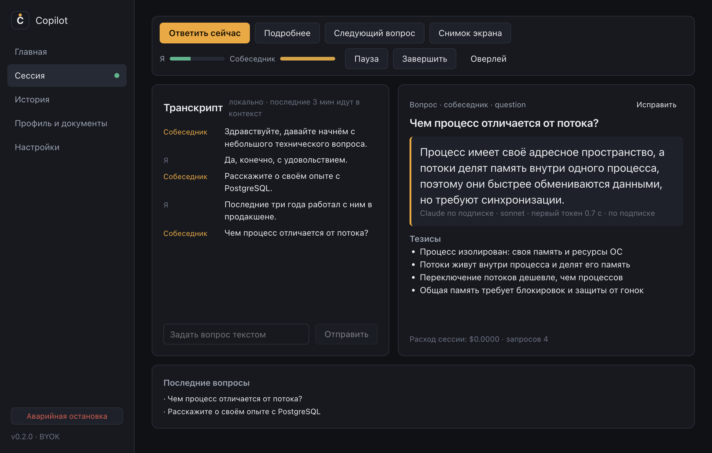
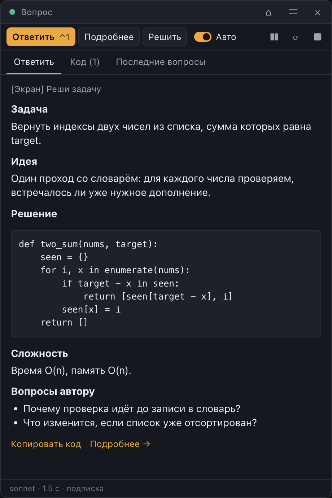

# Copilot for macOS

Live hints for interviews and meetings. The app listens to the conversation, transcribes speech on your Mac, spots questions, and shows a short answer in a small always-on-top window.

This is a fork of [Magerko/copilot](https://github.com/Magerko/copilot), which was built for Windows. This fork ports it to Apple Silicon Macs and adds new features. The Windows build is still in the code, but it has not been tested in this fork.

The interface is mostly in Russian. Choosing English in the settings translates only part of it. Questions and answers can be in Russian, Ukrainian, or English.

## Features
- **On-device speech recognition.** whisper.cpp runs locally on Metal. Audio never leaves your Mac and is never written to disk.
- **Your choice of model:** local (Ollama, LM Studio), cloud with an API key (OpenAI, Anthropic, Gemini, any OpenAI-compatible service), or Claude with your subscription.
- **Answers based on your documents.** Upload your resume and the job description. Anything missing from them is marked instead of being made up.
- **Solve a task from your screen.** One key captures the screen, then the model writes a solution and reviews any code it can see. You can also capture just a selected area.
- **Work from the small window.** Answer buttons, the auto-answer switch, and pause are all there, and the main window collapses during a session.
- **Usage tracking** for paid models, spending limits, and an offline mode that blocks external requests.

## What this fork adds
- macOS port: Apple Silicon build, code signing, whisper.cpp from Homebrew, system audio through ScreenCaptureKit.
- Claude with your subscription through the official Claude Code CLI, no API key needed.
- API key pool: when one key hits a limit, the request moves to the next key right away.
- One-key solving of tasks from the screen.
- Buttons and auto-answer in the hint window, plus a collapsing main window.
- Better pickup of quiet and short speech, with less CPU and GPU load.
- Number-based hotkeys that work with one hand on any keyboard layout.

## Screenshots
The data in these screenshots is fictional.




| Hint window | Solving a task from the screen |
|---|---|
|  |  |


| First launch | Consent |
|---|---|
|  |  |

| Providers | Privacy |
|---|---|
|  |  |

## Install on a Mac
You need macOS 13 or later, Apple Silicon, [Node.js](https://nodejs.org), and [Homebrew](https://brew.sh). There is no prebuilt release, so you build the app from source.

If you plan to rebuild the app more than once, [create the signing certificate](#signing-certificate) first.

```bash
git clone https://github.com/filooww/copilot.git
```

```bash
cd copilot && npm install
```

```bash
brew install whisper-cpp
```

```bash
npm run install:mac
```

The app appears in Applications. On first launch, allow access to the microphone and screen recording. Without screen recording, the app can't hear the other person.

### Signing certificate
macOS ties privacy permissions to the app's signature. Without a stable signature, every rebuild counts as a new app, so macOS keeps asking for permissions or silently stops granting them. If you only build once, you can skip this step.

To keep permissions across rebuilds:

1. Open Keychain Access. On recent macOS versions it is at `/System/Library/CoreServices/Applications/Keychain Access.app`.
2. Choose **Keychain Access → Certificate Assistant → Create a Certificate**.
3. Set the name to `Copilot Dev`, the identity type to **Self Signed Root**, and the certificate type to **Code Signing**.
4. Run `npm run install:mac` again.

`scripts/sign-mac.sh` finds the certificate by name. Without it, the script falls back to an ad-hoc signature and prints a warning.

If permissions are already stuck, reset them and launch the app again:

```bash
tccutil reset ScreenCapture app.copilot
```

```bash
tccutil reset Microphone app.copilot
```

### Claude with your subscription
Install Claude Code, then sign in from the app's settings:

```bash
brew install --cask claude-code
```

Requests count toward your subscription limits. Models that require usage credits won't respond without them.

## First launch
1. Choose your microphone and system audio.
2. Download a speech recognition model, from 160 MB to 1.3 GB.
3. Connect a model for answers.
4. Upload your resume and the job description (PDF, DOCX, TXT).

To send text to a cloud model, turn that on in Settings → Privacy. It is off by default.

## Modes
- **Interview / call** answers only the other person's voice from system audio.
- **Practice** also answers the voice from your microphone, so use it when the other person is sitting next to you.

## Hotkeys
| | macOS | Windows |
|---|---|---|
| Answer | `⌃1` | `Ctrl+Alt+Enter` |
| Solve a task from the screen | `⌃2` | `Ctrl+Alt+X` |
| More detail | `⌃3` | `Ctrl+Alt+E` |
| Capture a screen area | `⌃4` | `Ctrl+Alt+S` |
| Auto-answer | `⌃5` | `Ctrl+Alt+Q` |
| Show or hide hints | `⌃6` | `Ctrl+Alt+H` |
| Start a session, pause | `⌃7` | `Ctrl+Alt+L` |
| Emergency stop | `⌃⌥⌫` | `Ctrl+Alt+Backspace` |

You can change hotkeys in the settings.

## Limitations
- The hint window is flagged as hidden from screen capture, but that is not a guarantee: apps using ScreenCaptureKit on macOS 15 and later can still see it. Check for yourself before sharing your screen.
- Screen captures go to the model you selected, which means the cloud if that model is a cloud one. **Solve** sends the whole screen right away, so clear anything private first.
- Only record conversations and use AI hints where that is allowed, and tell the other participants. The app does not bypass proctoring or monitoring tools.

## For developers
```bash
npm install
```

```bash
npm test
```

```bash
npm run dev
```

Architecture and design decisions are in `docs/pipeline/`.

## Author and license
Original author: [Magerko](https://github.com/Magerko), Telegram [@magerdev1](https://t.me/magerdev1). MIT license, see [LICENSE](LICENSE).
